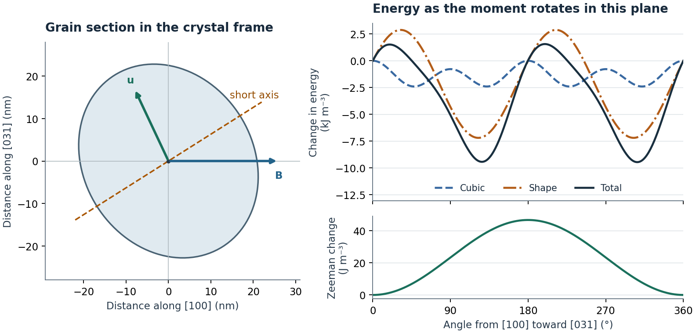
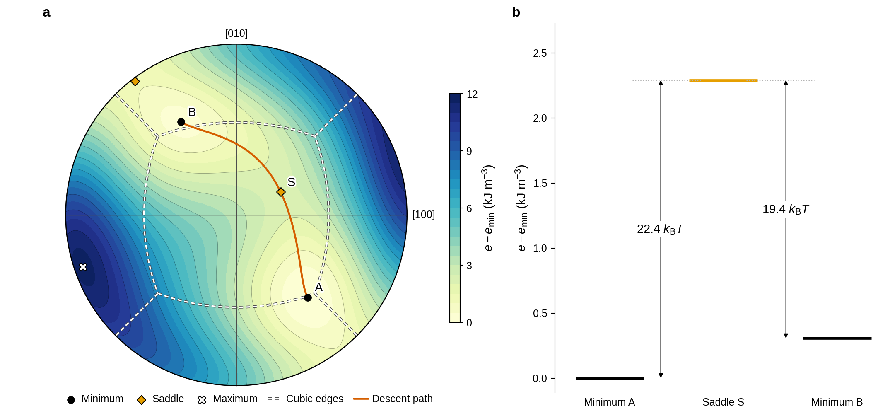
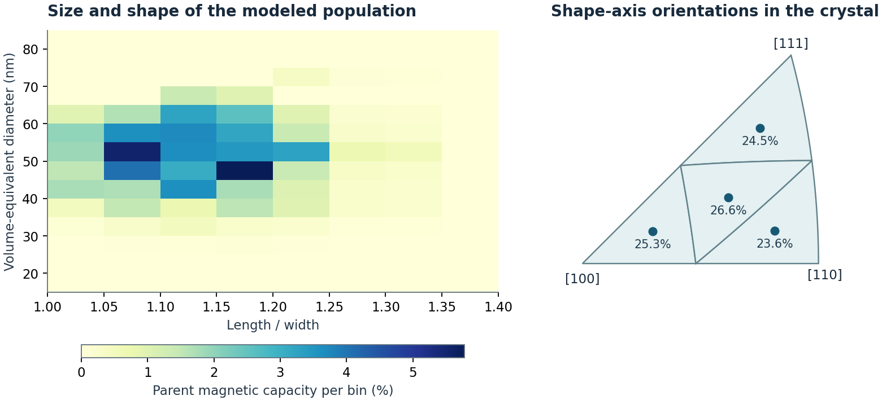
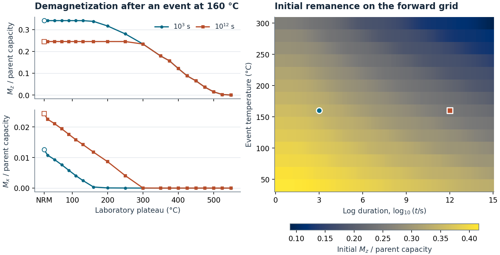
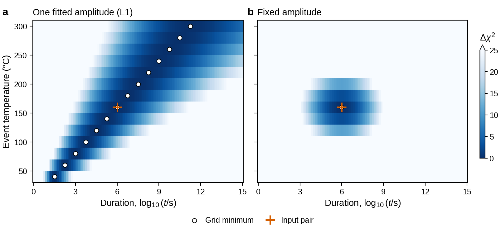

# MAGTHERMO

Under what conditions can a vector demagnetization curve from a characterized population of single-domain grains constrain the temperature and duration of a thermal event?

MAGTHERMO uses the single-domain energy-landscape and master-equation approach of the SDCC (Cych et al., 2025, and references therein), with its material laws and demagnetizing factors. Its own components are a stationary-point census for arbitrary internal crystal orientation and continuous shape, transport of occupations through state mergers and splits, integration over measured grain populations and joint temperature–duration recovery.

MAGTHERMO calculates the magnetization of noninteracting, single-domain grains during heating, a hold in an applied field, cooling and subsequent stepwise zero-field demagnetization. For each grain, the model combines cubic magnetocrystalline anisotropy, ellipsoidal shape anisotropy and the Zeeman energy. It locates minima and connecting saddles, evolves the occupation probabilities and sums the magnetic moments in specimen coordinates. Model F retains the full relaxation spectrum. Model N1 uses one relaxation time selected for its contribution to the magnetic signal.

## Grain geometry and anisotropy

A grain is an ellipsoid of revolution with volume-equivalent diameter $d$. Its symmetry axis can point in any direction relative to the cubic crystal axes. For a unit magnetization direction $\mathbf{u}$ in the crystal frame, the energy per unit volume is

$$
e(\mathbf{u}) =
K_1(u_x^2u_y^2+u_y^2u_z^2+u_z^2u_x^2)
+K_2u_x^2u_y^2u_z^2
+\frac{\mu_0 M_s^2}{2} \mathbf{u}^{\mathsf T}N\mathbf{u}
-M_s (\mathbf B\cdot\mathbf u) .
$$

The first two terms depend on crystal orientation. The demagnetizing tensor $N$ sets the shape contribution, and the applied field $\mathbf B$ favors alignment with the field. The model evaluates the magnetocrystalline constants $K_1$, $K_2$ and saturation magnetization $M_s$ at the grain temperature.



**Figure 1.** An oblate magnetite grain at 80 °C has a short axis parallel to [531] and a 50 µT field along [100]. The arrow $\mathbf{u}$ shows a possible moment direction. The curves follow one full turn in the plane shown, relative to the energy at 0°. The field contribution has its own scale in J m⁻³.

## Energy landscape and transitions between states

MAGTHERMO searches the sphere of moment directions for stationary points and classifies them by the two curvatures tangent to the sphere. Minima are stable moment directions. Descending from opposite sides of a first-order saddle identifies the minima it connects. The same saddle can present different barriers to a grain starting in different minima.



**Figure 2.** Energy landscape of an oblate single-domain magnetite grain with a volume-equivalent diameter of 45 nm. Its polar diameter is 39.9 nm along [531] and its equatorial diameter is 47.8 nm (polar/equatorial ratio 0.835). The grain is at 80 °C in a 50 µT field along [100]. The disk shows the lower crystal hemisphere in an equal-area projection. Dashed white lines trace the projected edges of the cubic unit cell. Orange paths descend from saddle S to minima A and B. The full sphere contains four minima, four saddles and two maxima. The barriers through S are 22.4 and 19.4 $k_BT$ from A and B, respectively.

For grain volume $V$, the barrier from minimum $i$ through saddle $s$ is $V(e_s-e_i)$. Thermal transition rates across the saddles define a master equation for the occupation probabilities. As temperature or field changes, the software tracks the minima and transfers probability through resolved state mergers and splits. The occupations at the end of each step supply the initial state for the next. [Landscape solver](src/r1_landscape.py) · [Occupation transport](src/er2_transport.py)

## From individual grains to a population

Size, shape and orientation play different roles. Grain volume scales both the activation barrier and the magnetic moment. The shape axis relative to the crystal affects the energy landscape. Rotation of the whole grain relative to the specimen determines how the applied field projects onto the crystal and how the grain moment contributes to the measured vector.



**Figure 3.** The magnetofossil (MF) model uses measured lengths and widths with an assumed prolate geometry. Color shows the fraction of the parent magnetic capacity in each size and shape bin. The four cells at right sample the direction of the shape axis in the crystal. Their weights are fractions of solid angle. The model integrates whole-grain rotations separately, assuming random specimen orientations.

## Forward curves and the temperature–duration grid

The protocol starts with remanence along specimen $z$. A field of 50 µT along $x$ acts during the thermal event. Heating, the isothermal hold and cooling change the grain occupations. The laboratory sequence then records the initial remanence and the remaining moment after each of 19 zero-field thermal demagnetization steps. All readings are taken at 20 °C. MAGTHERMO sums the grain moments in specimen coordinates, weighted by the modeled population.



**Figure 4.** At the same event temperature, the longer hold leaves less of the initial $z$ remanence and a larger $x$ component along the event field. The two marked grid points correspond to the curves at left. Color shows only the initial $z$ component. Each of the 14 × 121 grid points contains a full sequence of 20 three-component readings. These saved F-model calculations cover the full retained MF population using 17 shape nodes, 33 diameters per shape, four internal orientations and 12 specimen rotations. They illustrate the forward calculation at this resolution. [Vector curves](examples/model/forward_curves.csv) · [Grid values shown](examples/model/forward_grid.csv)

## Joint inversion of event temperature and duration

For one observed curve, the estimator compares all 60 measured components with their predicted values at every grid point. The primary fit (L1) allows one common nonnegative amplitude for the entire curve. At each temperature and duration it selects the amplitude that minimizes the sum of squared residuals weighted by the inverse component variances. If two predictions differ only by a positive scale factor, L1 cannot distinguish them. Differences in the direction of the remanence or in its decay across the laboratory steps can distinguish the predictions.



**Figure 5.** An analytic test isolates this ambiguity. Two signal components are proportional to temperature and log duration, respectively. With a fitted amplitude, all 14 marked pairs match the same input exactly. Fixing the amplitude gives one optimum at the input pair. The same estimator runs on physical curves. Joint recovery on the refined full-population physical reference and validation on rock specimens remain under evaluation. [Estimator](portao_a/inference.py) · [Estimator tests](portao_a/tests/test_inference.py)

## Crystal quadrature sensitivity at 40 °C


**Figure 6.** Event temperature was known (40 °C). The synthetic curves represent part of the MF magnetofossil population near a grain aspect ratio of 1.15, accounting for 13.662% of its modeled single-domain magnetic capacity. Both fits use 12 specimen rotations, a 50 µT event field and a fixed magnetization scale. C16 (16 crystal orientations) supplies the synthetic signal and serves as the operational reference for this comparison. At each of 121 durations per model, C4 (four crystal orientations) and C16 fit the same noisy observations. The line shows the RMS change in recovered log duration divided by the RMSE of the C16 control. Shading spans four blocks of 512 observations. Open circles identify inconclusive cases.

| Model | Detected quadrature effect | Inconclusive | Durations tested |
| --- | ---: | ---: | ---: |
| F | 120 | 1 | 121 |
| N1 | 97 | 24 | 121 |
| Total | 217 | 25 | 242 |

Changing the crystal quadrature affected the recovered duration in this test. The absolute accuracy of duration recovery remains unverified. In later controls on the full MF population at 40 and 300 °C, refining the specimen rotations produced the largest change in the modeled curves among the numerical refinements tested. At 40 °C, the initial remanence along the specimen *z* axis was about 21% higher for N1 and 24–25% higher for F with 12 rotations than with 48.

The fit uses 20 sequential vector readings, with the initial remanence followed by 19 zero-field steps. The example recalculates the estimates from the two saved synthetic curve banks, regenerates the verified noise matrix, and writes the figure and a row for every model and true duration. [Decision rule and data layout](examples/mf40/README.md) · [Physical and numerical settings](examples/mf40/protocol.json) · [Results table](examples/mf40/results.csv)

## Reproduce the figures and the sensitivity test

From a clone of this repository, use CPython 3.14.5. The following commands were tested on macOS arm64.

```sh
python3 -m venv .venv
. .venv/bin/activate
python -m pip install -r requirements.txt
PYTHONPATH=src:. python examples/model/figures.py
python examples/mf40/reproduce.py
```

Both commands run offline after installation. The first draws Figures 1–5 from the bundled model, saved numerical outputs and analytic estimator test. The second recalculates Figure 6 and the 242-row results table. [Figure inputs and methods](examples/model/README.md) · [Sensitivity test script](examples/mf40/reproduce.py)

## Model and tests

| Calculation | Implementation |
| --- | --- |
| Grain energy and stationary states | [Energy](src/e1_core.py), [energy landscape](src/r1_landscape.py) |
| Occupation transport and vector response | [Transport](src/er2_transport.py), [relaxation spectrum](src/wp1c_spectral.py), [response](src/er3_response.py) |
| Population integration | [Shape and size weights](portao_a/population.py), [orientation quadrature](portao_a/quadrature.py), [summation](portao_a/integration.py) |
| Thermal event and demagnetization | [Protocol](config/protocols.yaml), [chronological operator](src/er3_fast_geometry.py) |

Run the physical-limit, integration and estimator tests from the repository root.

```sh
PYTHONPATH=src:. python -m unittest discover -s portao_a/tests
PYTHONPATH=src:. python -m unittest discover -s tests
```

To calculate new size and shape weights from the external workbook, install `xlrd==2.0.2` and set `MAGTHERMO_SD_TABLE` to the path of `TM_Crit_Sizes.xls`. The saved-curve example includes its required numerical inputs. [Data sources and file checksums](SOURCES.md)

## Attribution and licensing

The forward model uses the material laws and ellipsoidal demagnetizing factors from the Single Domain Comprehensive Calculator (SDCC) by Brendan Cych. Its underlying model is described by Cych, Paterson, Nagy and Williams (2025). Three unmodified SDCC files from v0.4.3 are included. The upstream README and license file specify CC BY-SA 4.0. The accompanying source record documents the conflicting MIT classifier in the package metadata. This release adds no license for original MAGTHERMO code. [SDCC paper](https://doi.org/10.1093/gji/ggaf149) · [Software attribution and source files](SOURCES.md) · [SDCC license](LICENSES/SDCC-CC-BY-SA-4.0.txt)
