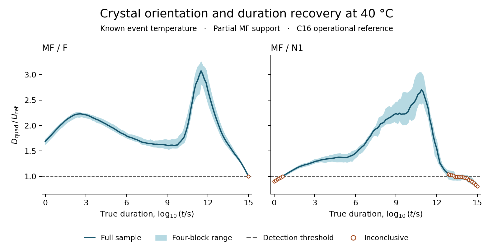

# MAGTHERMO

Under what conditions can a vector demagnetization curve from a characterized population of single-domain grains constrain the temperature and duration of a thermal event?

MAGTHERMO calculates the magnetization of noninteracting, single-domain grains during heating, a hold in an applied field, cooling and subsequent stepwise zero-field demagnetization. For each grain, the model combines cubic magnetocrystalline anisotropy, ellipsoidal shape anisotropy and the Zeeman energy. It locates minima and connecting saddles, evolves the occupation probabilities and sums the magnetic moments in specimen coordinates. Model F retains the full relaxation spectrum. Model N1 uses one relaxation time selected for its contribution to the magnetic signal.

## Duration recovery at 40 °C



**Figure 1.** Event temperature was known (40 °C). The synthetic curves represent part of the MF magnetofossil population near a grain aspect ratio of 1.15, accounting for 13.662% of its modeled single-domain magnetic capacity. C16, with 16 crystal orientations, provides the operational reference. At each of 121 durations per model, the four-orientation (C4) and C16 fits use the same noisy observations. The line shows the RMS change in recovered log duration divided by the RMSE of the C16 control. Shading spans four blocks of 512 observations. Open circles identify inconclusive cases.

| Model | Detected quadrature effect | Inconclusive | Durations tested |
| --- | ---: | ---: | ---: |
| F | 120 | 1 | 121 |
| N1 | 97 | 24 | 121 |
| Total | 217 | 25 | 242 |

Changing the crystal quadrature affected duration recovery in this experiment. C16's absolute error and the effect over the full MF population remain open. The fit uses 20 sequential vector readings, with the initial remanence followed by 19 zero-field steps. The example recalculates the estimates from the two saved synthetic curve banks, regenerates the verified noise matrix, and writes the figure and a row for every model and true duration. [Decision rule and data layout](examples/mf40/README.md) · [Physical and numerical settings](examples/mf40/protocol.json) · [Results table](examples/mf40/results.csv)

### Reproduce the figure and table

From a clone of this repository, use CPython 3.14.5. The following commands were tested on macOS arm64.

```sh
python3 -m venv .venv
. .venv/bin/activate
python -m pip install -r requirements.txt
python examples/mf40/reproduce.py
```

The script runs offline after installation. Outputs are written alongside the [reproduction script](examples/mf40/reproduce.py).

## Joint temperature and duration inference

The joint estimator searches a grid in event temperature and log duration. It can use a fixed amplitude or fit one nonnegative amplitude common to all 60 components. Analytic and synthetic tests cover both fits. As of 21 November 2026, the full-population physical reference calculation was still in progress. Recovery of both parameters from that reference and validation on rock specimens remain open. [Estimator](portao_a/inference.py) · [Estimator tests](portao_a/tests/test_inference.py)

## Model and tests

| Calculation | Implementation |
| --- | --- |
| Grain energy and stationary states | [Energy](src/e1_core.py), [energy landscape](src/r1_landscape.py) |
| Occupation transport and vector response | [Transport](src/er2_transport.py), [relaxation spectrum](src/wp1c_spectral.py), [response](src/er3_response.py) |
| Population integration | [Shape and size weights](portao_a/population.py), [orientation quadrature](portao_a/quadrature.py), [summation](portao_a/integration.py) |
| Thermal event and demagnetization | [Protocol](config/protocols.yaml), [chronological operator](src/er3_fast_geometry.py) |

Run the physical-limit, integration and estimator tests from the repository root.

```sh
PYTHONPATH=src python -m unittest discover -s portao_a/tests
PYTHONPATH=src python -m unittest discover -s tests
```

To calculate new size and shape weights from the external workbook, install `xlrd==2.0.2` and set `MAGTHERMO_SD_TABLE` to the path of `TM_Crit_Sizes.xls`. The saved-curve example includes its required numerical inputs. [Data sources and file checksums](SOURCES.md)

## Project history and attribution

Thales Pescarini owns and maintains MAGTHERMO. The public development history consists of 36 scientific changes selected from the research repository, followed by the preparation of this release. The historical commits retain the original authors, dates, messages and selected file contents. Filtering private project records from the original trees changed the commit hashes.

The forward model uses the material laws and ellipsoidal demagnetizing factors from the Single Domain Comprehensive Calculator (SDCC) by Brendan Cych. Its underlying model is described by Cych, Paterson, Nagy and Williams (2025). Three unmodified SDCC files from v0.4.3 are included. The upstream README and license file specify CC BY-SA 4.0. The accompanying source record documents the conflicting MIT classifier in the package metadata. This release adds no license for original MAGTHERMO code. [SDCC paper](https://doi.org/10.1093/gji/ggaf149) · [Software attribution and source files](SOURCES.md) · [SDCC license](LICENSES/SDCC-CC-BY-SA-4.0.txt)
