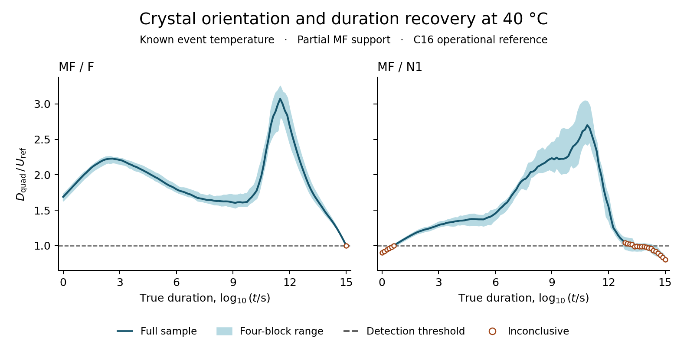

# Duration recovery at a known event temperature of 40 °C

The MF population represents magnetofossils. The synthetic curves cover a subset of its shape distribution around an aspect ratio of 1.15, representing 13.662% of the single-domain magnetic capacity. Each moment is expressed as a fraction of the full parent population capacity. C4 and C16 integrate over four and sixteen crystal orientations, respectively, with the same 12 specimen rotations, 33 diameters and physical protocol. C16 supplies the synthetic truth curves and serves as the operational reference. Its absolute quadrature error is unknown.

The event field was 50 µT along the specimen x axis. After the event and cooling, the PX12 sequence recorded the initial remanence and the remanence after each of 19 successive zero-field heating and cooling steps. The two input arrays retain all three Cartesian components at each reading. Their dimensions, in order, are duration (121), model (F, N1), reading (20) and component (x, y, z). The model F propagates the state occupations, and N1 uses a single relaxation time. The [protocol](protocol.json) gives the treatment temperatures, hold times, grid, noise settings and input checksums.

## Reproduction

From the repository root, run the following command with the dependencies installed.

```sh
python examples/mf40/reproduce.py
```

The script writes [results.csv](results.csv) and [quadrature.png](quadrature.png). Use `--output DIRECTORY` to choose another output directory. Each CSV row represents one true duration and one model. The columns give the noiseless fits, counts of tied noisy fits, and the full-sample and block-specific values of the quantities below.

## Estimator and decision rule

For each model, the grid is $\ell=\log_{10}(t/\mathrm{s})=0,0.125,\ldots,15$. At every true grid point, 2,048 noisy observations are formed by adding independent Gaussian errors to the 60 components of its C16 curve. The component standard deviation is $0.0025/\sqrt{2}$ in parent-capacity units. Within each model the same noise vectors are reused at all durations, so the cases have correlated noise. The generated values are checked against the SHA-256 of the original MF noise, in little-endian float64 C order.

Each C4 and C16 estimate minimizes the sum of squared residuals divided by the common variance, over all 121 grid points, using the **same observation**. The fit holds the event temperature, population, model, amplitude and noise scale fixed. Within each case, the two statistics in log-duration decades are

$$
D_{\mathrm{quad}}=\sqrt{\operatorname{mean}[(\hat\ell_{4}-\hat\ell_{16})^2]},\qquad
U_{\mathrm{ref}}=\sqrt{\operatorname{mean}[(\hat\ell_{16}-\ell)^2]}.
$$

The rule uses the full sample and four consecutive, disjoint blocks of 512. A case is inconclusive if the noiseless C16 control or any noisy fit has tied minima, or if $U_{\mathrm{ref}}<0.125$ in any of the five evaluations. The numerical tie tolerance is $64\,\epsilon_{64}\max(1,|\chi^2_{\min}|)$. With unique fits and sufficient grid resolution, the influence is detected if $D_{\mathrm{quad}}/U_{\mathrm{ref}}>1$ in all five evaluations and small if the ratio is below 0.3 in all five. All remaining cases are inconclusive. The block range describes variability among these four subsets.



**Figure 1.** Duration recovery at a known event temperature of 40 °C, with partial MF support and C16 as the operational reference. The line gives the ratio for all 2,048 observations. The shaded band spans the four block ratios. Open circles mark inconclusive cases. The comparison detects an effect of crystal quadrature in 120 of 121 F cases and 97 of 121 N1 cases. The remaining 25 cases are inconclusive. Temperature recovery was outside the scope of this test.
